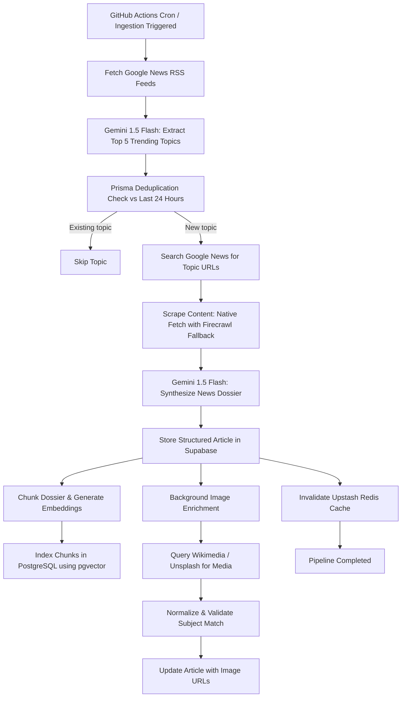

# Daily News Insights 📰

Daily News Insights is a fully autonomous, self-updating AI news platform. The platform monitors major tech, business, world, and political sources, retrieves the latest articles, scrapes full contents using a fast native scraping engine (with Firecrawl fallback), synthesizes editorial summaries and sentiment using Google Gemini 1.5 Flash, generates semantic vector embeddings, and caches the results using Upstash Redis. Users can interact with the articles database through a Retrieval-Augmented Generation (RAG) conversational agent.

---

## 🏛 Architecture & Tech Stack

The project is structured as a modern Monorepo:

- **`/frontend`**: Next.js (App Router, React 19, TypeScript), Tailwind CSS (v4), and Lucide React. Features a clean, responsive newspaper layout, real-time tickers, sentiment tags, and an interactive RAG chat interface. Hosted for free on **Vercel**.
- **`/backend`**: Node.js, Express, TypeScript, Prisma ORM (Supabase PostgreSQL with `pgvector`), Upstash Redis (`ioredis`), Google News RSS, and Google Gen AI (Gemini 1.5 Flash / `gemini-embedding-001`).
  - **Unified Express API**: Serves news endpoints (`/api/news`), semantic RAG search & conversational agent (`/api/rag`), location proxying (`/api/location`), user authentication (`/api/auth`), and admin panel tasks (`/api/admin`).
- **Autonomous Ingestion Workflow**: Automated background cron pipeline running via **GitHub Actions** (free 2,000 min/month), handling RSS feed ingestion, Gemini editorial synthesis, vector indexing into `pgvector`, and image enrichment.

---

## 🔄 Core Ingestion Pipeline Workflow



---

## 💬 The RAG Chat Engine

The RAG Chat & Search service provides a grounded conversational agent where users can ask questions about the ingested news:

- **Embeddings**: Uses Google's `gemini-embedding-001` (768-dimensional vectors) to embed both user queries and article chunks.
- **Retrieval**: Searches the `ArticleChunk` table in Supabase PostgreSQL using cosine distance (`<=>` operator with `pgvector`) with similarity thresholds to retrieve the most relevant context blocks.
- **Synthesis**: Feeds the context blocks into Gemini 1.5 Flash alongside chat history, instructing the model to remain grounded strictly in the retrieved news articles, citing sources, headlines, and publication timestamps.
- **On-Demand Live Ingestion**: If a user asks about an event not yet covered in the database, the RAG engine performs real-time inline ingestion from Google News to synthesize the context on-the-fly.

---

## 🚀 100% Free Deployment Guide

### 1. Database & Cache (Supabase & Upstash)
1. **Supabase**: Create a free project on [Supabase](https://supabase.com/). In the SQL Editor, enable `pgvector`:
   ```sql
   CREATE EXTENSION IF NOT EXISTS vector;
   ```
   Copy the `DATABASE_URL` (Connection string -> URI).
2. **Upstash Redis**: Create a free serverless Redis database on [Upstash](https://upstash.com/) and copy the `REDIS_URL`.

---

### 2. Deploy Backend (Koyeb or Render)

#### Option A: Koyeb (Recommended - 24/7 Always On)
1. Sign up at [koyeb.com](https://www.koyeb.com/).
2. Click **Create App** -> **GitHub**.
3. Select `surajarya0007/Daily-News-Insights`.
4. Set **Root Directory** to `backend`.
5. Under **Environment Variables**, add:
   - `DATABASE_URL`: `your_supabase_postgres_uri`
   - `REDIS_URL`: `your_upstash_redis_uri`
   - `GEMINI_API_KEY`: `your_gemini_api_key`
   - `PORT`: `8080`
   - `NODE_ENV`: `production`
6. Click **Deploy**. Koyeb gives you a public URL (e.g. `https://daily-news-backend-xyz.koyeb.app`).

#### Option B: Render
1. Sign up at [render.com](https://render.com/).
2. Create a **New Web Service** -> Connect `Daily-News-Insights`.
3. Set **Root Directory** to `backend`.
4. Environment: `Docker` (or Node with Build: `npm run prisma:generate && npm run build`, Start: `npm start`).
5. Add the same environment variables as above.

---

### 3. Deploy Frontend to Vercel

1. Go to [vercel.com](https://vercel.com/) and click **Add New Project**.
2. Import the `surajarya0007/Daily-News-Insights` repository.
3. Set **Root Directory** to `frontend`.
4. Under **Environment Variables**, add:
   - `NEXT_PUBLIC_API_URL`: `https://your-backend-app.koyeb.app`
   - `NEXT_PUBLIC_RAG_API_URL`: `https://your-backend-app.koyeb.app`
5. Click **Deploy**.

---

### 4. Setup Automated Ingestion via GitHub Actions

The ingestion pipeline runs automatically every 30 minutes for free via GitHub Actions:
1. In your GitHub repository, go to **Settings** -> **Secrets and variables** -> **Actions**.
2. Add the following **Repository Secrets**:
   - `DATABASE_URL`: `your_supabase_postgres_uri`
   - `REDIS_URL`: `your_upstash_redis_uri`
   - `GEMINI_API_KEY`: `your_gemini_api_key`
   - `FIRECRAWL_API_KEY`: (optional)
   - `UNSPLASH_ACCESS_KEY`: (optional)
3. You can manually trigger the pipeline anytime under the **Actions** tab by selecting `Scheduled News Ingestion Pipeline` -> **Run workflow**.

---

## 🛠 Local Development

### 1. Backend Setup
```bash
cd backend
npm install
npx prisma generate
npm run dev
```
The unified backend runs on `http://localhost:8080` (or `PORT=5000 npm run dev`).

### 2. Frontend Setup
```bash
cd frontend
npm install
npm run dev
```
The Next.js client runs on `http://localhost:3000`.

### 3. Ingestion Test Locally
```bash
cd backend
npm run cron:ingest
```

---

## 📄 License
MIT
